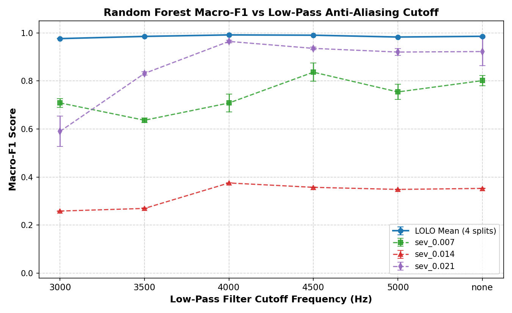

# Bearing Fault Classification with Generalization Benchmarking

## What This Project Does

This project benchmarks machine learning models for vibration-based bearing fault classification using the Case Western Reserve University dataset. It extracts 21 time, frequency, and envelope features from raw accelerometer signals after applying a fixed 3500 Hz low-pass filter as a safeguard against a possible sampling-rate artefact. Classification performance is evaluated under file-isolated leave-one-load-out and cross-severity cross-validation using Support Vector Machines, Random Forests, and XGBoost. Unsupervised anomaly detection with Isolation Forests and clustering with DBSCAN are analyzed to assess out-of-distribution fault discovery and natural grouping behavior. Systematic stress-testing under additive Gaussian sensor noise and low-pass filter cutoff sweeps quantifies model degradation patterns and operational failure modes.

---

## Dataset and Data Access

Data is sourced from the Bearing Data Center at the Case School of Engineering, Case Western Reserve University (CWRU). The experimental benchmark utilizes 40 drive-end accelerometer recordings:
- **Classes:** Normal (healthy baseline), Ball fault, Inner Race fault, and Outer Race fault (centered at 6 o'clock position).
- **Fault Severities:** 0.007", 0.014", and 0.021" diameter electro-discharge machined defects (the 0.028" severity is completely excluded because Outer Race data was not collected at that depth).
- **Motor Loads:** 0, 1, 2, and 3 HP (corresponding to approximate rotational speeds of 1797, 1772, 1750, and 1730 RPM).
- **Sampling Rates:** The 36 fault files were acquired at 12 kHz. The four Normal baseline files (97.mat to 100.mat) are treated as 48 kHz recordings. This is inferred from their sample counts (97.mat has exactly the same length, 243,938 samples, as the 48 kHz fault file 109.mat), because the CWRU pages do not state the sampling rate of the Normal files. They are resampled to 12 kHz using scipy.signal.resample_poly(x, 1, 4).

The raw `.mat` files are not stored in this Git repository. Running `src/phase1_data_verify.py` automatically downloads the 40 required files from the official server using the URL pattern `https://engineering.case.edu/sites/default/files/{file_id}.mat`. File 109.mat is not part of the 40-file dataset. It is the 48 kHz recording of the same fault and load as 105.mat (Inner Race 0.007", 0 HP) and is used only as a control in the two diagnostic scripts. src/download_control_file.py downloads it into data/raw/109.mat.

---

## Evaluation Design

The benchmark enforces strict data isolation to prevent data leakage (`results/phase3_splits_summary.csv`):
- **File-Level Splitting:** Vibration signals are windowed into 2048-sample windows with 50% overlap (1024-sample step). Because adjacent overlapping windows from the same recording are near-copies, all train/test splits are partitioned strictly by file ID. Windows from any single file never cross a train/test boundary.
- **Leave-One-Load-Out (LOLO):** Four outer folds where all files from one motor load (0, 1, 2, or 3 HP) are held out for testing (10 test files: 3 per fault class, 1 Normal file; 30 training files). Each fold contains three inner cross-validation folds across the remaining training loads for hyperparameter tuning.
- **Cross-Severity Generalization:** Three outer rotations where one defect severity (0.007", 0.014", or 0.021") is held out for testing across all motor loads (13 test files: 4 Inner Race, 4 Ball, 4 Outer Race, and 1 Normal file; 27 training files). Hyperparameter tuning is conducted using three inner load-based folds.
- **Normal Class Consideration:** Each test fold contains exactly one Normal recording (58 windows at 0 HP; 117 windows at 1, 2, and 3 HP). Consequently, per-fold Normal metrics are sensitive to single-recording properties.
- **Evaluation Metrics:** Multiclass macro-averaged F1 score (`macro_f1`) serves as the primary performance metric, accompanied by per-class recall, precision, and confusion matrices. Balanced class weights for SVM and Random Forest and balanced sample weights for XGBoost.

---

## Pipeline

The pipeline consists of 14 sequential scripts:

| Step | Script | Purpose | Main Inputs | Main Outputs |
| :--- | :--- | :--- | :--- | :--- |
| 1 | `src/phase1_data_verify.py` | Download 40 `.mat` files, resample Normal files from 48 kHz to 12 kHz, count windows, audit metadata | Remote server CWRU URLs / `data/raw/` | `data/processed/phase1_signals_12k.pkl`, `results/phase1_file_manifest.csv` |
| 2 | `src/download_control_file.py` | Download and validate CWRU control file 109.mat (48 kHz Drive-End fault) | Remote server (`https://engineering.case.edu/sites/default/files/109.mat`) | `data/raw/109.mat` |
| 3 | `src/phase2_diagnostics.py` | Diagnose sampling rate roll-off discrepancy between resampled and native files via control pair 109 vs 105 | `data/processed/phase1_signals_12k.pkl`, `data/raw/109.mat` | `results/phase2_diagnostics_summary.txt`, `results/diagnostic_filter_rolloff.png`, `results/diagnostic_envelope_spectra.png` |
| 4 | `src/phase2b_leakage_fix.py` | Evaluate 3500 Hz low-pass filter and 1500-3000 Hz envelope band on control pair and 40 files | `data/processed/phase1_signals_12k.pkl`, `results/phase1_file_manifest.csv`, `data/raw/109.mat` | `results/phase2b_leakage_fix_summary.txt`, `results/diagnostic_leakage_fix.png` |
| 5 | `src/phase2_features.py` | Extract 21 time, frequency, and envelope features across 4,643 windows for filtered (`lp3500`) and unfiltered (`nolp`) data; run pilot evaluation on fold 3 | `data/processed/phase1_signals_12k.pkl`, `results/phase1_file_manifest.csv` | `data/processed/phase2_features_lp3500.csv`, `data/processed/phase2_features_nolp.csv`, `results/feature_groups.json`, `results/phase2_features_summary.txt`, `results/pilot_lolo_fold3.txt` |
| 6 | `src/phase3_splits.py` | Generate file-isolated outer and inner cross-validation folds for LOLO and severity splits | `results/phase1_file_manifest.csv`, `data/processed/phase2_features_lp3500.csv`, `data/processed/phase2_features_nolp.csv` | `data/processed/phase3_splits.json`, `results/phase3_splits_summary.csv` |
| 7 | `src/phase4_train_eval.py` | Benchmark SVM, Random Forest, and XGBoost with nested tuning across 7 splits; run 7-row ablation | `data/processed/phase2_features_lp3500.csv`, `data/processed/phase2_features_nolp.csv`, `data/processed/phase3_splits.json`, `results/phase3_splits_summary.csv`, `results/feature_groups.json`, `results/phase1_file_manifest.csv` | `results/phase4_metrics.csv`, `results/phase4_confusion.csv`, `results/phase4_per_file.csv`, `results/phase4_importance.csv`, `data/processed/phase4_predictions.csv`, `results/phase4_ablation.csv`, `data/processed/phase4_best_params.json`, `results/phase4_summary.md` |
| 8 | `src/phase4b_class_severity_means.py` | Compute mean feature values by class and severity to diagnose cross-severity transfer drop | `data/processed/phase2_features_lp3500.csv` | `results/phase4b_class_severity_means.csv` |
| 9 | `src/phase5_unsupervised.py` | Evaluate Isolation Forest novelty detection (Exp 1A and 1B) and DBSCAN clustering with PCA | `data/processed/phase2_features_lp3500.csv`, `data/processed/phase2_features_nolp.csv`, `data/processed/phase3_splits.json`, `results/phase3_splits_summary.csv`, `results/feature_groups.json` | `results/phase5_novelty_A.csv`, `results/phase5_novelty_B.csv`, `results/phase5_dbscan.csv`, `results/phase5_dbscan_crosstab.csv`, `results/phase5_dbscan_eps_sensitivity.csv`, `results/phase5_summary.md`, `results/diagnostic_phase5_kdistance.png` |
| 10 | `src/phase5b_cluster_files.py` | Audit DBSCAN cluster composition per file across the four LOLO test folds | `data/processed/phase2_features_lp3500.csv`, `results/feature_groups.json`, `data/processed/phase3_splits.json`, `results/phase5_dbscan.csv` | `results/phase5_dbscan_cluster_files.csv` |
| 11 | `src/phase6_noise_robustness.py` | Evaluate clean models under additive Gaussian noise (Variants A & B at 30, 20, 10, 5 dB) | `data/processed/phase1_signals_12k.pkl`, `results/phase1_file_manifest.csv`, `data/processed/phase2_features_lp3500.csv`, `data/processed/phase3_splits.json`, `data/processed/phase4_best_params.json`, `results/phase4_metrics.csv` | `results/phase6_metrics.csv`, `results/phase6_effective_snr_variant_a.csv`, `results/phase6_effective_snr_variant_b.csv`, `results/phase6_envelope_vs_snr.csv`, `results/phase6_summary.md`, `results/fig_phase6_macro_f1_vs_snr.png`, `results/fig_phase6_envelope_vs_snr.png`, `data/processed/phase6_cache/` |
| 12 | `src/phase6b_power_above_3500.py` | Quantify signal power removed by 3500 Hz low-pass filter and high-frequency spectral power fractions | `data/processed/phase1_signals_12k.pkl`, `results/phase1_file_manifest.csv` | `results/phase6b_power_above_3500.csv` |
| 13 | `src/phase6b_noise_confusion.py` | Generate 4-class confusion matrices under noise (Variants A and B at 10 and 5 dB) across LOLO splits | `data/processed/phase2_features_lp3500.csv`, `data/processed/phase3_splits.json`, `data/processed/phase4_best_params.json`, `results/phase6_metrics.csv`, `data/processed/phase6_cache/` | `results/phase6b_noise_confusion.csv` |
| 14 | `src/phase6c_cutoff_sensitivity.py` | Test Random Forest sensitivity to filter cutoffs (3000, 3500, 4000, 4500, 5000 Hz, and none) | `results/phase1_file_manifest.csv`, `data/processed/phase1_signals_12k.pkl`, `data/processed/phase3_splits.json`, `data/processed/phase2_features_lp3500.csv`, `data/processed/phase2_features_nolp.csv`, `results/phase4_ablation.csv` | `results/phase6c_cutoff_metrics.csv`, `results/phase6c_per_file.csv`, `results/phase6c_power_removed.csv`, `results/phase6c_cutoff_summary.md`, `results/fig_phase6c_cutoff_vs_macro_f1.png` |

---


## How to Run

### Setup Environment

Use a fresh virtual environment without system site packages (the default of python -m venv).

**Linux:**
```bash
python3 -m venv .venv
source .venv/bin/activate
pip install -r requirements.txt
python src/phase1_data_verify.py
python src/download_control_file.py
```

**Windows:**
```cmd
py -m venv .venv
.venv\Scripts\activate
pip install -r requirements.txt
python src\phase1_data_verify.py
python src\download_control_file.py
```

**Platform Note:** Developed and run on Ubuntu Linux. Windows has not been tested; the packages are cross-platform, but this was not checked on Windows. These scripts use Linux-style /tmp paths: `src/phase1_data_verify.py` (`/tmp/cwru_test`), `src/phase2_diagnostics.py` (`/tmp/matplotlib`), `src/phase2b_leakage_fix.py` (`/tmp/matplotlib`), `src/phase6_noise_robustness.py` (`/tmp/matplotlib`), and `src/phase6c_cutoff_sensitivity.py` (`/tmp/matplotlib`); they are harmless on Linux and untested on Windows. `src/phase4_train_eval.py` installs xgboost with pip if it is missing, so install requirements.txt first.

### Run Pipeline

To run the complete pipeline sequentially on Linux:
```bash
python src/phase1_data_verify.py
python src/download_control_file.py
python src/phase2_diagnostics.py
python src/phase2b_leakage_fix.py
python src/phase2_features.py
python src/phase3_splits.py
python src/phase4_train_eval.py
python src/phase4b_class_severity_means.py
python src/phase5_unsupervised.py
python src/phase5b_cluster_files.py
python src/phase6_noise_robustness.py
python src/phase6b_power_above_3500.py
python src/phase6b_noise_confusion.py
python src/phase6c_cutoff_sensitivity.py
```

---


## Main Results

### 1. Supervised Benchmark Across Splits
The table below reports macro-F1 across the four load folds and three severity rotations. The Phase 4 summary uses population standard deviations (`ddof=0`), while the Phase 6 baseline summary uses sample standard deviations (`ddof=1`):

| Model | LOLO Mean Macro-F1 (ddof=0) | LOLO Mean Macro-F1 (ddof=1) | Severity Mean Macro-F1 (ddof=0) | Severity Mean Macro-F1 (ddof=1) | Weakest Split |
| :--- | :--- | :--- | :--- | :--- | :--- |
| **SVM** | 0.9760 +- 0.0249 | 0.9760 +- 0.0288 | 0.5968 +- 0.2470 | 0.5968 +- 0.3026 | `sev_0.014` (0.2482) |
| **Random Forest** | 0.9852 +- 0.0216 | 0.9852 +- 0.0249 | 0.6112 +- 0.2696 | 0.6112 +- 0.3302 | `sev_0.014` (0.2691) |
| **XGBoost** | 0.9835 +- 0.0217 | 0.9835 +- 0.0251 | 0.4871 +- 0.1169 | 0.4871 +- 0.1431 | `sev_0.014` (0.3747) |

*(Data source: `results/phase4_summary.md` Table 1; `results/phase6_summary.md` Table 1).*

### 2. Feature Ablation Benchmark (Random Forest)
| Ablation Configuration | Features | Feature Count | LOLO Mean Macro-F1 | Severity Mean Macro-F1 |
| :--- | :--- | :--- | :--- | :--- |
| **1_dummy_majority** | none | 0 | 0.1166 +- 0.0021 | 0.1177 +- 0.0002 |
| **2_rms_only** | rms | 1 | 0.7715 +- 0.0130 | 0.4716 +- 0.1582 |
| **3_time_only** | time | 9 | 0.9605 +- 0.0287 | 0.4487 +- 0.1654 |
| **4_time_freq** | time + freq | 15 | 0.9723 +- 0.0347 | 0.4509 +- 0.1639 |
| **5_full_lp3500** | full (filtered) | 21 | 0.9854 +- 0.0217 | 0.5790 +- 0.2330 |
| **6_full_nolp** | full (unfiltered) | 21 | 0.9857 +- 0.0143 | 0.6921 +- 0.2451 |
| **7_lp3500_no_loudness** | no_loudness | 18 | 0.9852 +- 0.0183 | 0.4707 +- 0.1257 |

*(Data source: `results/phase4_summary.md` Table 3; `results/phase4_ablation.csv`).*

### 3. Unsupervised Novelty Detection (Isolation Forest)
| Experiment | Task | Variant | Comparison / Class | Mean AUROC +- Std |
| :--- | :--- | :--- | :--- | :--- |
| **Exp 1A** | Unseen Fault Detection | `lp3500_all21` | Inner Race (overall) | 0.9458 +- 0.0249 |
| **Exp 1A** | Unseen Fault Detection | `lp3500_all21` | Ball (overall) | 0.4464 +- 0.0242 |
| **Exp 1A** | Unseen Fault Detection | `lp3500_all21` | Outer Race (overall) | 0.9318 +- 0.0078 |
| **Exp 1B** | Normal-Only Detector | `lp3500_all21` | All Faults (overall) | 0.9650 +- 0.0319 |
| **Exp 1B** | Normal-Only Detector | `rms_only_baseline` | All Faults (overall) | 1.0000 +- 0.0000 |

*(Data source: `results/phase5_summary.md` Tables 1 and 2).*

### 4. Unsupervised Clustering (DBSCAN across LOLO Test Folds)
| Metric | `lolo_0` | `lolo_1` | `lolo_2` | `lolo_3` | Mean +- Std |
| :--- | :--- | :--- | :--- | :--- | :--- |
| **Clusters Found** | 2 | 5 | 5 | 4 | 4.00 |
| **Noise Fraction** | 0.0188 | 0.0128 | 0.0094 | 0.0195 | 0.0151 +- 0.0042 |
| **Adjusted Rand Index (ARI)** | 0.0554 | 0.2175 | 0.2172 | 0.1436 | 0.1584 +- 0.0667 |
| **Normalized Mutual Info (NMI)** | 0.1857 | 0.4449 | 0.4454 | 0.3683 | 0.3611 +- 0.1060 |

*(Data source: `results/phase5_summary.md` Table 3).*

### 5. Noise Robustness across SNR Levels (LOLO Macro-F1)
| Variant | Model | Clean | 20 dB | 10 dB | 5 dB |
| :--- | :--- | :--- | :--- | :--- | :--- |
| **Variant A (Proportional)** | SVM | 0.9760 +- 0.0288 | 0.9661 +- 0.0247 | 0.6158 +- 0.0869 | 0.2720 +- 0.0579 |
| **Variant A (Proportional)** | Random Forest | 0.9852 +- 0.0249 | 0.9848 +- 0.0268 | 0.9819 +- 0.0302 | 0.9216 +- 0.0405 |
| **Variant A (Proportional)** | XGBoost | 0.9835 +- 0.0251 | 0.9826 +- 0.0265 | 0.9740 +- 0.0223 | 0.8998 +- 0.0534 |
| **Variant B (Fixed Ref)** | SVM | 0.9760 +- 0.0288 | 0.9501 +- 0.0246 | 0.6143 +- 0.0546 | 0.4253 +- 0.0276 |
| **Variant B (Fixed Ref)** | Random Forest | 0.9852 +- 0.0249 | 0.9848 +- 0.0260 | 0.6596 +- 0.0445 | 0.6185 +- 0.0249 |
| **Variant B (Fixed Ref)** | XGBoost | 0.9835 +- 0.0251 | 0.9825 +- 0.0274 | 0.7871 +- 0.1036 | 0.6262 +- 0.0163 |

Normal recall in Variant B at 10 dB: SVM 0.9272, Random Forest 0.0029, XGBoost 0.2533; at 5 dB: 0.9315, 0.0000, 0.0000 (results/phase6_summary.md Table 2).

*(Data source: `results/phase6_summary.md` Table 1; sample standard deviations with ddof=1).*

### 6. Filter Cutoff Sensitivity (Random Forest, Seed 42)
| Cutoff Frequency | LOLO Mean Macro-F1 | Severity Mean Macro-F1 | Mean Seed Std | Normal Power Removed | Fault Power Removed (OR / IR / Ball) |
| :--- | :--- | :--- | :--- | :--- | :--- |
| **3000 Hz** | 0.9761 +- 0.0220 | 0.5190 +- 0.1905 | 0.0120 | 49.02% | 76.11% / 55.83% / 71.57% |
| **3500 Hz** | 0.9854 +- 0.0217 | 0.5790 +- 0.2330 | 0.0035 | 45.17% | 44.36% / 26.89% / 23.36% |
| **4000 Hz** | 0.9915 +- 0.0086 | 0.6826 +- 0.2412 | 0.0063 | 42.07% | 5.81% / 3.04% / 1.88% |
| **4500 Hz** | 0.9904 +- 0.0085 | 0.7097 +- 0.2526 | 0.0064 | 7.37% | 2.13% / 0.38% / 0.78% |
| **5000 Hz** | 0.9828 +- 0.0150 | 0.6743 +- 0.2401 | 0.0070 | 2.40% | 1.85% / 0.15% / 0.42% |
| **none (unfiltered)** | 0.9857 +- 0.0143 | 0.6921 +- 0.2451 | 0.0117 | 0.00% | 0.00% / 0.00% / 0.00% |

*(Data source: `results/phase6c_cutoff_summary.md` Tables 1 and 3; `results/phase6b_power_above_3500.csv`).*

---

## Figures


*Figure 1: Classifier macro-F1 across signal-to-noise ratios from clean down to 5 dB for proportional noise (Variant A) and fixed reference noise (Variant B).*


*Figure 2: Top row: class-matched envelope peak-to-median ratios; bottom row: class-wise kurtosis, from clean to 5 dB, for Variant A and Variant B.*


*Figure 3: Random Forest macro-F1 across low-pass filter cutoffs from 3000 Hz to unfiltered data across load and severity splits.*

---

## Limitations

1. Ball fault labels. The envelope check supports the Ball labels only on part of the files (mean envelope ratio at the ball spin frequency 1.36 to 1.90 across severities, against 1.38 for Normal; results/phase4b_class_severity_means.csv). Consequence: Ball labels rest on the CWRU file numbering, and the Ball files merge into one large cluster with Normal (results/phase5_dbscan_cluster_files.csv).
2. Low-pass attenuation. The common 3500 Hz low-pass removes on average 44.36% of the power of Outer Race files (52.31% at 0.014"), 26.89% of Inner Race (34.61% at 0.007", 39.20% at 0.014", 6.86% at 0.021"), 23.36% of Ball and 45.17% of Normal (results/phase6b_power_above_3500.csv). Consequence: content above 3500 Hz, and part of the content just below it, is not available to the models; whether it carries fault information was not tested beyond the cutoff sweep.
3. Resampling leakage evidence. It rests on one control pair (file 109 resampled vs file 105; local output results/phase2_diagnostics_summary.txt, regenerated by src/phase2_diagnostics.py). Consequence: the effect of the resampling filter cannot be separated from physical differences between healthy and damaged bearings.
4. Normal sample size. Exactly one Normal recording is used per load (58 windows at 0 HP, 117 at 1, 2 and 3 HP; results/phase3_splits_summary.csv). Consequence: per-fold Normal metrics depend on a single recording.
5. Pilot scope. The pilot used one fold (lolo_3) with 10 test files (local output results/pilot_lolo_fold3.txt, regenerated by src/phase2_features.py). Consequence: it cannot show whether the low-pass matters; the low-pass is a safeguard, not a demonstrated improvement.
6. Loudness. Amplitude features can dominate: rms alone reaches 0.7715 macro-F1 across load folds (results/phase4_summary.md). Removing the three loudness features leaves load macro-F1 unchanged (0.9852) and does not improve severity macro-F1 (0.4707 vs 0.5790). Consequence: loudness is not the only reason for the severity failure.
7. Inner cross-validation in the severity splits. Tuning uses leave-one-load-out inner folds (data/processed/phase3_splits.json). Consequence: model selection optimizes for load transfer, not for transfer to an unseen fault size.
8. Amplitude scale and roll-off. Ratio (Resampled 109 / Native 105) in 2000-4000 Hz (reference): +5.10 dB; Ratio in 4000-4500 Hz: +16.24 dB; Ratio in 4500-5000 Hz: +11.55 dB; Ratio in 5000-5900 Hz: +10.86 dB (local output results/phase2_diagnostics_summary.txt, regenerated by src/phase2_diagnostics.py). Consequence: the absolute loudness and high-frequency content of the Normal class, the only class from 48 kHz recordings, may not be directly comparable with the fault classes; an rms-only score reaches AUROC 1.0 in Experiment 1B, which says little about generalisation.
9. Failure modes under noise. At 10 and 5 dB, Random Forest and XGBoost raised false alarms (Normal windows predicted as fault classes) and never predicted a fault window as Normal, while the SVM predicted 14.95% to 52.22% of fault windows as Normal (results/phase6b_noise_confusion.csv). Consequence: in this synthetic-noise test the SVM missed faults and the tree models raised false alarms.
10. Cutoff sensitivity. Cutoffs of 4000 and 4500 Hz give a higher severity macro-F1 (0.6826 and 0.7097) than 3500 Hz (0.5790), with load macro-F1 unchanged within the spread (0.9915 and 0.9904 vs 0.9854); the severity differences lie within the spread of the three splits (about 0.19 to 0.25), and the 0.014" weakness persists at every cutoff (results/phase6c_cutoff_summary.md). Consequence: the 3500 Hz filter may remove fault information in the 3500-4000 Hz band; the cutoff was fixed before these tests and only Random Forest was tested.

---


## Reproducibility

- **Random Seeds:**
  - `np.random.seed(42)` is set at the top of 11 scripts: `src/phase2_diagnostics.py`, `src/phase2_features.py`, `src/phase2b_leakage_fix.py`, `src/phase3_splits.py`, `src/phase4_train_eval.py`, `src/phase5_unsupervised.py`, `src/phase5b_cluster_files.py`, `src/phase6_noise_robustness.py`, `src/phase6b_power_above_3500.py`, `src/phase6b_noise_confusion.py`, and `src/phase6c_cutoff_sensitivity.py`.
  - `random_state=42` is used for estimators and PCA in `src/phase2_features.py`, `src/phase4_train_eval.py`, `src/phase5_unsupervised.py`, `src/phase5b_cluster_files.py`, `src/phase6_noise_robustness.py`, `src/phase6b_noise_confusion.py`, and `src/phase6c_cutoff_sensitivity.py`. (Note: `src/phase3_splits.py` and `src/phase6b_power_above_3500.py` set `np.random.seed(42)` but contain no `random_state` parameter).
  - `random.seed(42)` is set in `src/phase4_train_eval.py`.
  - Seeds `[0, 1, 2, 3, 4]` are evaluated in `src/phase5_unsupervised.py` for Isolation Forest novelty detection.
  - Seeds `[42, 0, 1]` are evaluated in `src/phase6c_cutoff_sensitivity.py` for Random Forest cutoff sensitivity.
  - Deterministic pseudo-random noise in `src/phase6_noise_robustness.py` is seeded per file, SNR level, and repetition using `zlib.crc32`.
  - Results were produced on Ubuntu Linux with Python 3.14.4. The packages numpy, scipy, scikit-learn and xgboost came from the virtual environment (PyPI builds); matplotlib and pandas came from the Ubuntu system packages (same version numbers as in requirements.txt). Other versions or builds may change numbers slightly.
  - A re-run of phases 1 to 4 in a clean environment with the PyPI packages of requirements.txt reproduced the macro-F1 values of results/phase4_metrics.csv and results/phase4_ablation.csv identically (maximum absolute difference 0, on the same machine). Phases 5 and 6 were not re-run.
- **Tracked vs. Local Files:**
  - Tracked in Git: All code in `src/`, package requirements in `requirements.txt`, documentation in `README.md`, and all final result tables and figures in `results/` (`.csv`, `.md`, `.json`, and `fig_*.png`).
  - Created Locally (not tracked): Raw `.mat` downloads in `data/raw/`, processed signal pickles and cached feature tables in `data/processed/`, and intermediate text summaries and diagnostic figures (`results/*.txt`, `results/diagnostic_*.png`).

---


## Repository Layout

```
.
├── .gitignore               # Git untracked pattern specifications
├── data/
│   ├── processed/           # Processed signals, splits, features, and model caches (local, not tracked)
│   └── raw/                 # Downloaded .mat files (local, not tracked)
├── results/                 # Metrics, summaries, figures, and analysis reports (tracked)
├── src/                     # Pipeline implementation scripts (tracked)
├── README.md                # Project documentation
└── requirements.txt         # Environment package specifications
```

---


## Data Credit

Vibration recordings were collected by the Bearing Data Center at the Case School of Engineering, Case Western Reserve University (CWRU).
